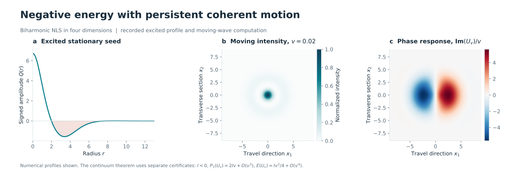
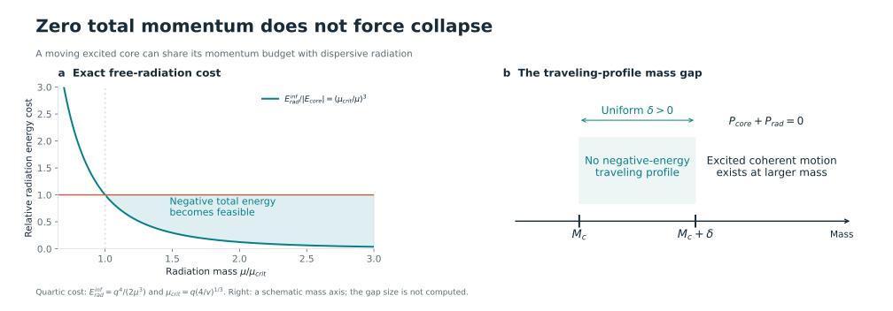
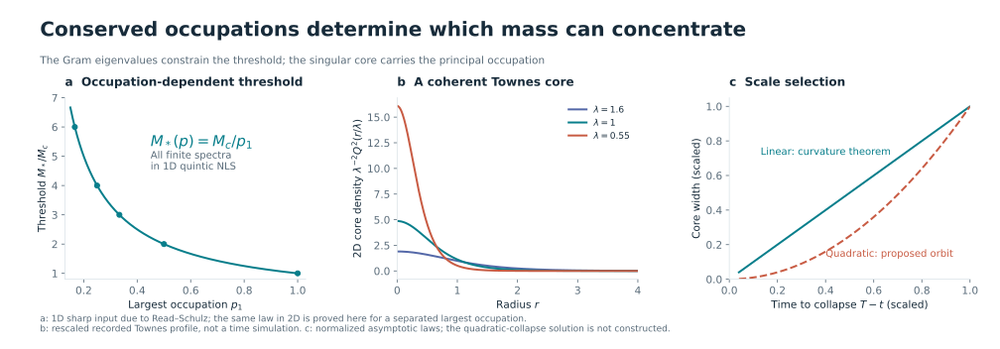
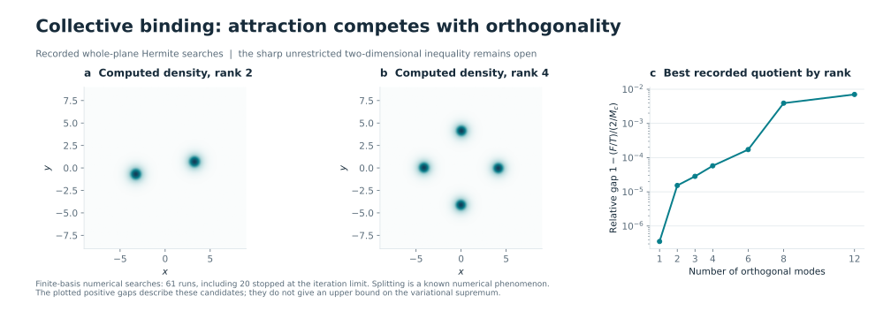
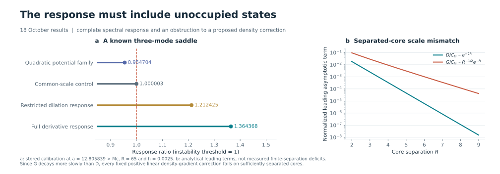
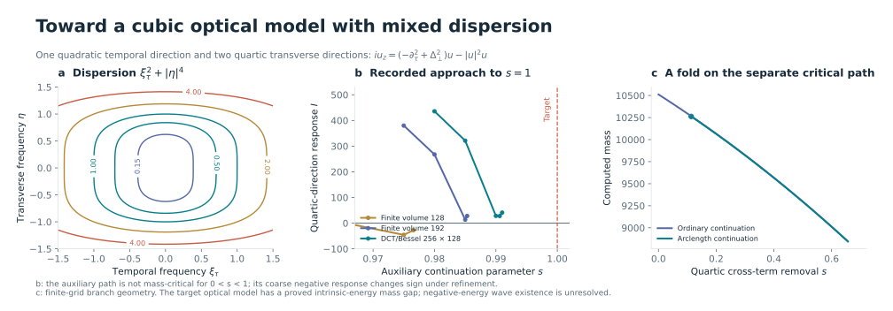

# Critical Focusing Dynamics

**Coherent motion, conserved occupations, and collapse**  
Shuxing Yang

[Latest research files](#recent-research-files) · [中文](README.zh-CN.md) · [Research narrative](RESEARCH.md) · [Results and proofs](RESULTS.md) · [All files](CONTENTS.md) · [Original filenames](catalog/files.md) · [References](references/README.md)

**When does a focusing wave concentrate, and when can it remain in coherent motion?** At critical scaling, dispersion and nonlinear attraction scale together. A sharp mass threshold controls this balance, while momentum, phase response, and conserved modal occupations determine the available dynamics.

The research develops three connected questions: negative-energy global motion and its mass gap; occupation-dependent thresholds and the structure of a collapsing core; and the competition between collective attraction and orthogonality. [The first paper](papers/negative-energy/README.md) brings together the negative-energy results; the repository also contains the subsequent occupation and collective-binding work.

The starting point was [Leonard Dinh’s radial blowup paper, published on Meta AI’s research site on 2 October 2026](https://ai.meta.com/research/publications/finite-time-blow-up-of-radial-negative-energy-solutions-for-the-mass-critical-biharmonic-nonlinear-schrodinger-equation/), following Boulenger–Lenzmann. This project asks what happens when radial symmetry is removed. Its negative-energy traveling waves and zero-momentum constructions show why the unrestricted extension fails; the mass gap identifies where that coherent mechanism cannot occur. The [source comparison](references/README.md) gives the precise relationship to the earlier results.

## 1. Negative energy can coexist with global coherent motion

For mass-critical biharmonic NLS,

$$
i\partial_tu=\Delta^2u-|u|^{8/N}u,
$$

three- and four-dimensional excited profiles generate global traveling waves with negative Hamiltonian energy. The mechanism is a negative phase response,

$$
I=\langle\partial_1Q,L_-^{-1}\partial_1Q\rangle<0,
\qquad P_1(U_v)=2Iv+O(v^3),
\qquad E(U_v)=\frac I4v^2+O(v^4).
$$

The momentum of a slow wave points opposite to its velocity. Translation preserves its shape and Sobolev norms, so energy sign alone cannot impose nonradial collapse. The waves are spectrally unstable; the construction describes exact coherent motion and specified approaching trajectories.

*Recorded numerical profiles. The finite-grid moving state illustrates the mechanism; the continuum existence statements use separate exact and interval certificates.*

[N4 manuscript](manuscripts/biharmonic-certificates/BNLS-Nonradial-Research-20261007.pdf) · [N3 theorem](theory/zero-momentum/n3-full-theorem.md) · [Spectral dynamics](theory/spectral-dynamics/README.md) · [Profile data](computations/excited-waves/axial-profiles/) · [Certificates](computations/biharmonic-certificates/)

## 2. Momentum can be cancelled, but the profile mass gap remains

In four dimensions, both a pair of separating waves and a single coherent core with radiation give exact forward-global solutions with **zero total momentum and negative energy**. For a core of momentum magnitude $q$ and speed $v$, quartic free radiation of mass $\mu$ has the sharp energy infimum

$$
E_{\mathrm{rad}}^{\inf}=\frac{q^4}{2\mu^3},
\qquad \mu_{\mathrm{crit}}=q\left(\frac4v\right)^{1/3}.
$$

Every strict excess over this radiation mass can be realized in the construction. At small speed, the total mass approaches the excited-state mass rather than twice that mass. Near the scalar critical mass, optimizer phase coercivity excludes negative-energy traveling profiles:

$$
E(U)<0\quad\Longrightarrow\quad M(U)\ge M_c+\delta,
\qquad \delta>0.
$$

*The left curve is an exact normalized free-radiation cost. The right mass axis is schematic: the theorem establishes a positive gap without assigning its optimal numerical width. General changing trajectories require additional dynamical arguments.*

[Single-core construction, 18 October](theory/coherent-radiation/wave-radiation.md) · [Mass-gap manuscript](manuscripts/profile-mass-gap/BNLS-Mass-Gap-and-Momentum-20261007.pdf) · [Moment-free residual](theory/coherent-radiation/robust-gap.md) · [Endpoint bounds](theory/coherent-radiation/endpoint.md) · [General dispersion](theory/homogeneous-dispersion/README.md)

## 3. Occupations select the critical core

For common-density Schrödinger systems,

$$
i\partial_tu_j+\Delta u_j+\rho^{2/d}u_j=0,
\qquad \rho=\sum_j|u_j|^2,
$$

the entire Gram matrix $\Gamma_{jk}=\langle u_j,u_k\rangle$ is conserved. Its normalized eigenvalues $p_1\ge p_2\ge\cdots$ encode modal occupations. In the two-dimensional cubic model, $p_2/p_1\le\varepsilon_0$ gives the sharp threshold $M_*(p)=M_c/p_1$. At the critical principal mass,

$$
E(U)\ge\frac12 E_{\mathrm{scalar}}(u_1)
+\frac1{64}\sum_{j\ge2}\|\nabla u_j\|_2^2.
$$

The occupation-ratio bound is independent of rank and total secondary occupation. Thus a critical singularity has one coherent principal core while the remaining occupations retain bounded kinetic energy. The arguments also give exact-spectrum endpoint constructions, core transport, and countably many-mode extensions under their stated hypotheses.

*The threshold curve uses the one-dimensional quintic law for all finite spectra, with the sharp Read–Schulz inequality as external input. In two dimensions the same formula is proved in the specified occupation regime. The Townes curves are profile rescalings. The linear collapse law has curvature hypotheses; the dashed quadratic law is a proposed mechanism whose singular orbit remains unconstructed.*

[Fixed-occupation manuscript](manuscripts/fixed-occupation/Fixed-Occupation-Thresholds.pdf) · [Sharp threshold](theory/occupation-thresholds/occupation-gap.md) · [Core and background](theory/critical-core/README.md) · [Scale and phase](theory/scale-and-phase/README.md) · [Background interaction](theory/background-interaction/README.md)

## 4. Can several orthogonal modes bind more efficiently than one?

Overlapping modes increase nonlinear attraction; orthogonality costs kinetic energy. In two dimensions this competition leads to

$$
F=\int\left(\sum_j|\phi_j|^2\right)^2,\quad
T=\sum_j\|\nabla\phi_j\|_2^2,\quad
\langle\phi_i,\phi_j\rangle=\delta_{ij},
\qquad F\ \stackrel{?}{\le}\ \frac2{M_c}T.
$$

The unrestricted inequality is equivalent to the corresponding sharp Lieb–Thirring constant. The work establishes specific separated-core deficits, transverse estimates, all-scale Townes scattering signs, finite separated-well spectral counts, and arbitrary-rank matrix remainders. The full two-dimensional sharp inequality remains open.

*Densities reconstructed from saved Hermite coefficients. The search includes 61 runs, of which 20 reached the iteration limit. Its candidates remain below the scalar quotient; this does not settle the global supremum. Numerical fragmentation has precedents in the literature.*

[Variational problem](theory/collective-threshold/README.md) · [Separated cores](theory/separated-cores/README.md) · [All-scale scattering](theory/all-scale-scattering/main-theorem.md) · [Matrix remainders](theory/matrix-remainders/README.md) · [Hermite data](computations/hermite-optimization/) · [Periodic searches](computations/periodic-potentials/)

## 5. Full spectral response changes what a restricted perturbation can detect

The complete response includes adjustment through unoccupied states. A Schur-complement identity gives the correction to restricted dilation tests. In a recorded three-mode saddle, quadratic potential tests remain below the instability threshold, whereas the complete derivative response exceeds it.

The same research stage rules out a proposed universal linear density-gradient correction: for two separated Townes cores the original deficit decays as $e^{-2R}$, while the proposed correction decays more slowly, as $R^{-1/2}e^{-R}$.

*The response calculation concerns a known saddle with parameter $a>M_c$. The asymptotic comparison disproves the stronger auxiliary inequality, while leaving the original sharp inequality unresolved.*

[Response identity](theory/full-response/response-schur.md) · [Density-gradient obstruction](theory/full-response/density-gradient.md) · [Numerical calibration](computations/full-response/r31_response_calibration.json)

## 6. The optical connection requires the correct dispersion and scaling

A cubic model with one quadratic temporal direction and two quartic transverse directions is mass-critical under anisotropic scaling:

$$
i\partial_z u=(-\partial_\tau^2+\Delta_\perp^2)u-|u|^2u,
\qquad
u_\lambda(z,\tau,x_\perp)=\lambda^2u(\lambda^4z,\lambda^2\tau,\lambda x_\perp).
$$

Its $L^2$ mass corresponds to normalized integrated optical intensity. The Hamiltonian $E$ measures the balance of dispersion and focusing; it is a different quantity. Removing temporal drift gives the intrinsic energy $E_{\mathrm{int}}=E-|P_\tau|^2/(2M)$. The profile gap and quantitative residual extend to this model, uniformly over positive-semidefinite transverse quadratic corrections.

*19 October continuation data. Refinement reverses an apparent negative response, and a separate mass-critical continuation path folds. The closest saved spectral state reaches $s=0.991015625$ on an auxiliary path; it is not a solution at the optical target $s=1$. Existence of a negative intrinsic-energy traveling wave in that target model remains unresolved.*

[Mixed-model theorem](theory/coherent-radiation/anisotropic-gap.md) · [Uniform residual](theory/coherent-radiation/robust-mixed-extension.md) · [Optical correspondence](theory/coherent-radiation/physical-bridge.md) · [Continuation results and commands](theory/mixed-dispersion-continuation/README.md) · [All recorded states](computations/mixed-dispersion-continuation/)

## Recent research files

| Date of research | Development | Direct access |
|---|---|---|
| 19 October | Two continuation paths toward the mixed optical equation | [Results](theory/mixed-dispersion-continuation/README.md) · [Five solvers and checkpoints](computations/mixed-dispersion-continuation/core_continuation/) |
| 18 October | One core with radiation, profile residuals, mixed-dispersion gap, endpoint identities | [Manuscript](manuscripts/coherent-radiation/Negative-Energy-Coherent-Dynamics-Advances-20261018.pdf) · [Eleven derivations](theory/coherent-radiation/README.md) |
| 18 October · R31 | Full spectral response and density-gradient obstruction | [Derivations](theory/full-response/README.md) · [Computation](computations/full-response/) |
| 18 October · R30 | Arbitrary-rank remainder, density transfer and action reduction | [Seven derivations](theory/matrix-remainders/README.md) |
| 16 October · R28 | Square and triangular periodic potential searches | [Analysis](theory/periodic-potentials/README.md) · [Data](computations/periodic-potentials/) |
| 9–15 October · R15–R25 | Occupation thresholds, core dynamics, scale selection and separated-core theory | [All results](RESULTS.md) · [Development](HISTORY.md) · [Original files](catalog/files.md) |

## Read and reproduce

| Need | Entry |
|---|---|
| Equations, common mechanism and mathematical connections | [Research narrative](RESEARCH.md) / [中文](RESEARCH.zh-CN.md) |
| Exact statements, hypotheses and proof locations | [Results catalogue](RESULTS.md) |
| Manuscripts, derivations, programs and data | [Complete contents](CONTENTS.md) |
| Locate a file by its original name or package | [Original-filename index](catalog/files.md) |
| Figure definitions, input data and regeneration | [Figures](figures/README.md) |
| Numerical methods and execution commands | [Computations](COMPUTATIONS.md) |
| Prior work and open questions | [References](references/README.md) · [Open problems](OPEN_PROBLEMS.md) |

The repository contains 32 recovered research packages and four standalone records. Three previously named optical artifacts remain unavailable; their names and coverage are recorded [here](catalog/README.md). The figures above are generated from the retained data and explicit formulas.

Copyright © 2026 Shuxing Yang. All rights reserved.
